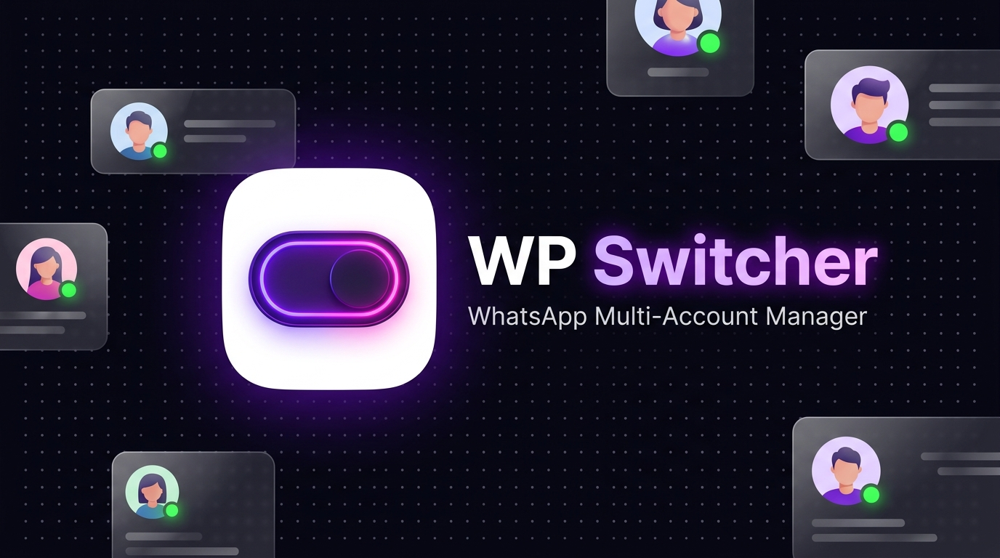

<p align="center">
  
</p>

<p align="center">
  <strong>Switch seamlessly between multiple WhatsApp Web accounts in parallel tabs within the same browser profile.</strong>
</p>

<p align="center">
  
  
  
  
  
</p>

---

## ⚡ Overview

**WP Switcher** is an ultra-fast, bloat-free Chrome extension designed to solve one major headache: **running multiple WhatsApp Web accounts simultaneously on a single computer.**

Normally, WhatsApp Web restricts you to a single session per browser profile. Workarounds like opening Incognito tabs force you to re-scan QR codes every time you close your browser, and managing multiple Chrome user profiles creates cluttered windows, high memory consumption, and disorganized workflows.

**WP Switcher introduces true client-side storage isolation**, intercepting IndexedDB, LocalStorage, SessionStorage, and BroadcastChannels directly in the page realm. Each account runs in its own tab, completely isolated and permanently logged in.

---

## ✨ Features

- 🚀 **Unlimited Concurrent Accounts**: Run 2, 5, or 10+ WhatsApp accounts side-by-side in separate tabs within your regular browser profile.
- 🔒 **Permanent Session Persistence**: Sessions stay logged in across browser restarts. Scan your QR code once, and never scan it again.
- 🛡️ **Zero Telemetry & 100% Private**: Operates entirely client-side. No intermediate servers, no cloud proxies, and zero external tracking. Your credentials and chats remain strictly between your device and WhatsApp.
- 🎨 **AMOLED Dark Aesthetic**: Crafted with a neon purple (`#a855f7`) and hot pink (`#ff007f`) aesthetic designed for modern power users.
- 🔄 **Real-Time Profile Capture**: Automatically detects and displays your account name, phone number, and avatar directly on the popup cards.
- ✏️ **Account Customization (Pencil Edit)**: Rename accounts (e.g., *Work Support*, *Personal VIP*, *Sales Lead*) and assign custom theme colors for instant recognition.
- ⚡ **1-Click Instant Focus & Switching**: Click any account in the switcher to jump straight to that active tab or open a fresh tab instantly.
- 🔄 **Built-in GitHub Release Checker**: Checks for new updates directly from the official repository with 1-click update archive downloads.
- 🧹 **One-Click Fresh Start**: Clean wipe utility that clears tab sessions and cached keys with a single click.

---

## 📊 Comparison Matrix

| Feature | Regular WhatsApp Web | Incognito Windows | Multiple Chrome Profiles | **WP Switcher** |
| :--- | :---: | :---: | :---: | :---: |
| **Simultaneous Accounts** | 1 | 2 (1 normal + 1 incognito) | Unlimited (separate windows) | **Unlimited (single window)** |
| **Session Persistence** | ✅ Yes | ❌ Lost on tab close | ✅ Yes | **✅ Permanent** |
| **Single-Window Workflow** | ✅ Yes | ❌ Cluttered | ❌ Cluttered | **✅ Unified Tab Bar** |
| **System Memory Usage** | Normal | High | Very High (Multiple Chrome Instances) | **Minimal (Shared Engine)** |
| **One-Click Tab Switcher** | ❌ No | ❌ No | ❌ No | **✅ Built-in Popup** |
| **Profile Identification** | ❌ None | ❌ None | Manual icon | **✅ Auto Name, Phone & Avatar** |

---

## 🛠️ Architecture & How It Works

WP Switcher isolates sessions at runtime using prototype hooking in the page's **MAIN world** (`document_start`).

```
┌────────────────────────────────────────────────────────┐
│                   WP Switcher Engine                   │
├────────────────────────────────────────────────────────┤
│  Browser Tab: https://web.whatsapp.com/?wsi=acc_sales  │
│                                                        │
│   ┌────────────────────────────────────────────────┐   │
│   │             MAIN Realm: inject.js              │   │
│   │   - Prefix isolation: "acc_sales::"            │   │
│   │   - Hooks: IDBFactory.prototype.open           │   │
│   │   - Hooks: Storage.prototype.getItem/setItem   │   │
│   │   - Hooks: BroadcastChannel & navigator.locks  │   │
│   │   - Traps: SharedWorker (Security isolation)   │   │
│   └───────────────────────▲────────────────────────┘   │
│                           │ window.postMessage         │
│   ┌───────────────────────▼────────────────────────┐   │
│   │            ISOLATED: content.js                │   │
│   │   - Bridges messages to background service     │   │
│   └───────────────────────▲────────────────────────┘   │
│                           │ chrome.runtime             │
│   ┌───────────────────────▼────────────────────────┐   │
│   │           Service Worker: background.js        │   │
│   │   - Tab tracking & session registry            │   │
│   │   - Persistent storage (chrome.storage.local)  │   │
│   └────────────────────────────────────────────────┘   │
└────────────────────────────────────────────────────────┘
```

1. **URL Binding (`?wsi=<session_id>`)**: Each WhatsApp tab receives a unique session identifier. The default account runs with zero prefix (`P = ''`) to keep pre-existing logins intact.
2. **IndexedDB Sandboxing**: The extension proxies `indexedDB.open()`, prepending `${sessionId}::` to every database table (e.g. `wawc`, `model-storage`), preventing database lock contention and token collisions.
3. **Storage Namespacing**: `localStorage` and `sessionStorage` methods (`getItem`, `setItem`, `removeItem`, `key`, `clear`) are scoped dynamically so each account only sees its own session keys.
4. **Channel & Lock Partitioning**: Isolates `BroadcastChannel` and `navigator.locks.request` to ensure background synchronization workers from different accounts never cross-communicate.

---

## 📥 Installation

WP Switcher is open-source and easy to install directly in Google Chrome, Brave, Microsoft Edge, Opera, or any Chromium-based browser:

1. **Clone or Download this Repository**:
   ```bash
   git clone https://github.com/expgg/WP-Switcher.git
   ```
   *Or click **Code > Download ZIP** from [GitHub](https://github.com/expgg/WP-Switcher) and extract the folder to your computer.*

2. **Open Extensions in Chrome**:
   - Navigate to `chrome://extensions/` in your browser address bar.
   - Turn **ON** the **Developer mode** toggle in the top-right corner.

3. **Load the Extension**:
   - Click the **Load unpacked** button in the top-left corner.
   - Select the `WP-Switcher` directory (the folder containing `manifest.json`).

4. **Pin and Launch**:
   - Click the extension puzzle icon in your Chrome toolbar and pin **WP Switcher**.
   - Click the WP Switcher switch icon to launch!

---

## 🚀 Quick Start Guide

### 1. Link Your Accounts
- Click the **Add New Account** button. A fresh isolated tab will open automatically.
- Scan the displayed QR code with your phone.
- Once connected, WP Switcher automatically syncs your WhatsApp name, phone number, and avatar!

### 2. Rename & Color Code
- Click the ✏️ **Pencil icon** on any account card.
- Set a custom alias (e.g. `Support Team`, `Client Ops`, `Family`) and pick a theme color.
- Your customized name is preserved permanently and won't be overwritten.

### 3. Switch in One Click
- Open the WP Switcher popup anytime.
- Click **Switch** to focus an open account, or **Open** to launch an offline account into a new tab.

---

## 🔄 Updates & Releases

### Release Schedule & Versioning
WP Switcher follows [Semantic Versioning](https://semver.org/). Releases and changelogs are published on GitHub under [Releases](https://github.com/expgg/WP-Switcher/releases).

### In-App Update Checker
Click **Check for Updates** in the popup footer at any time. The extension will query the official GitHub repository for new tags and commits:
- If a newer build is available, the popup displays release highlights and a direct 1-click download button.
- Simply replace your local extension files or run `git pull` and click the extension reload icon on `chrome://extensions`.

### Releases & Changelog

#### `v1.0.1` (Current)
- 🖼️ **Custom Avatar Upload**: Users can now upload and crop their own custom avatar images directly from the edit modal.
- 📱 **Raw Phone Formatting**: Completely ditched country codes, quotes, and `+` artifacts for pure, clean national digits.
- 🎨 **Creator Credits Footer**: Custom animated glowing pulse footer credit linked to [r1fat.pages.dev](https://r1fat.pages.dev).
- 🧹 **Streamlined Footer**: Repositioned GitHub Update Checker and removed legacy wipe controls.

#### `v1.0.0`
- ✨ Initial public release with Manifest V3 multi-account isolation engine.
- 🎨 AMOLED dark theme with custom accent chips and 1-click tab switching.

---

## 🔒 Security & Privacy Statement

- **Zero Cloud Storage**: WP Switcher does not store, log, or transmit any user communications, encryption keys, tokens, or personal information.
- **Local Sandbox**: All session data is isolated strictly on your local machine using standard browser storage mechanisms.
- **Auditable Source**: 100% vanilla JavaScript, HTML, and CSS. No obfuscated bundles, no binary dependencies, and no remote code execution.

---

## 📄 License

This project is licensed under the [MIT License](LICENSE).
Feel free to fork, contribute, and adapt it for your own workflows!
